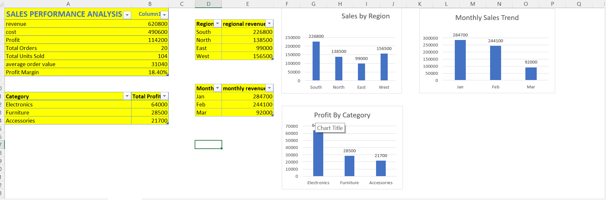

📊 Sales Performance Analysis Dashboard | Excel

📌 Project Overview
The Sales Performance Analysis Dashboard is an Excel-based data analytics project designed to analyze sales performance across regions, months, and product categories.

The dashboard presents key business metrics and visualizations to help users understand revenue, costs, profitability, and sales trends.

🎯 Project Objectives
- Analyze overall sales performance.
- Calculate key performance indicators (KPIs).
- Compare revenue across different regions.
- Analyze monthly revenue trends.
- Identify the most profitable product categories.
- Present business data using charts and visualizations.

🛠️ Tools & Technologies
- Microsoft Excel
- Excel Formulas
- Data Analysis
- Data Visualization
- Column Charts

📈 Key Performance Indicators (KPIs)
- Total Revenue: 620,800
- Total Cost: 490,600
- Total Profit: 114,200
- Total Orders: 20
- Total Units Sold: 104
- Average Order Value: 31,040
- Profit Margin: 18.40%

📊 Dashboard Features

1. Sales by Region
Compares revenue across South, North, East, and West regions.

2. Monthly Sales Trend
Visualizes revenue for January, February, and March.

3. Profit by Category
Compares profits across Electronics, Furniture, and Accessories.

🔍 Key Business Insights
- South generated the highest regional revenue of 226,800.
- East generated the lowest regional revenue of 99,000.
- Electronics recorded the highest category profit of 64,000.
- Accessories recorded the lowest category profit of 21,700.
- January recorded the highest monthly revenue of 284,700.
- The overall profit margin is approximately 18.40%.

💡 Skills Demonstrated
- Excel formulas and calculations
- KPI development
- Data summarization
- Data visualization
- Business insights and reporting
- Dashboard formatting

🚀 Future Improvements
- Add interactive PivotTables and slicers.
- Introduce filters for region and product category.
- Add more KPIs and business insights.
- Improve the dashboard layout and interactivity.

👩‍💻 Author
Srujana Boya

Aspiring Data Analyst | Excel | SQL | Python

---
This project was developed for learning and demonstrating foundational data analysis and visualization skills using Microsoft Excel.

📊 Dashboard Preview

